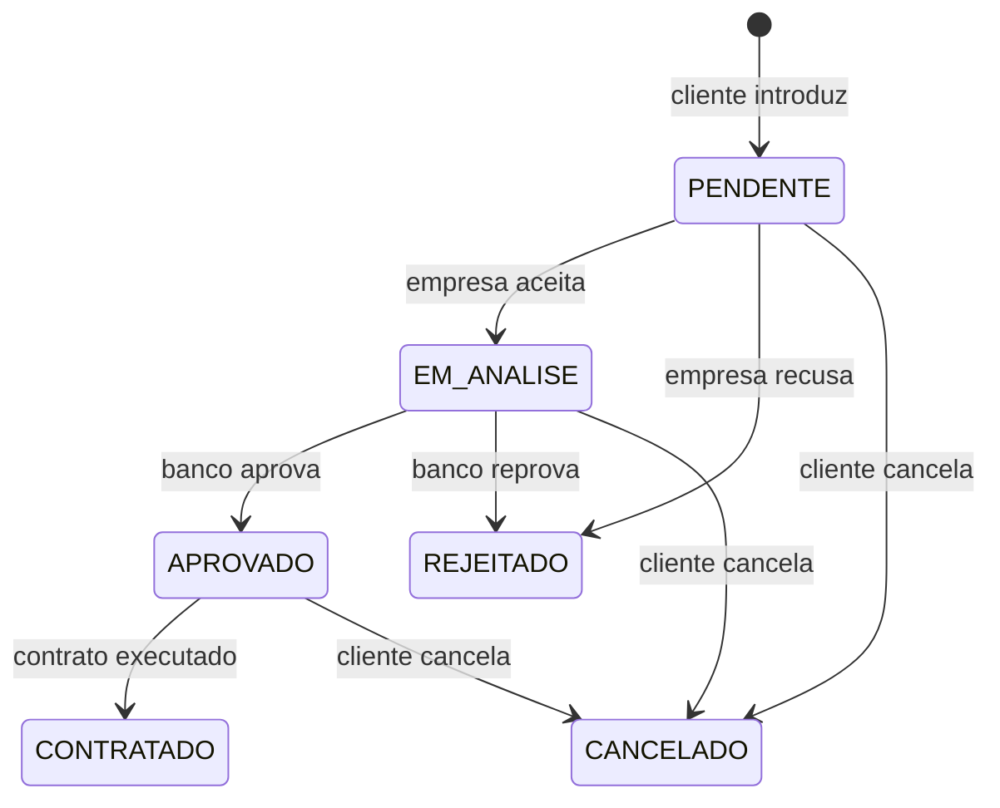
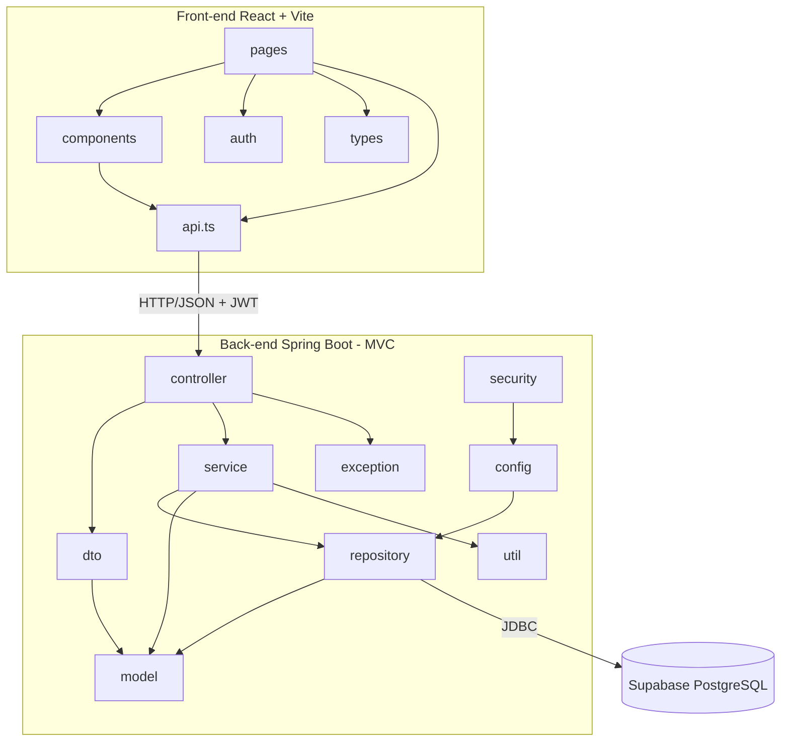
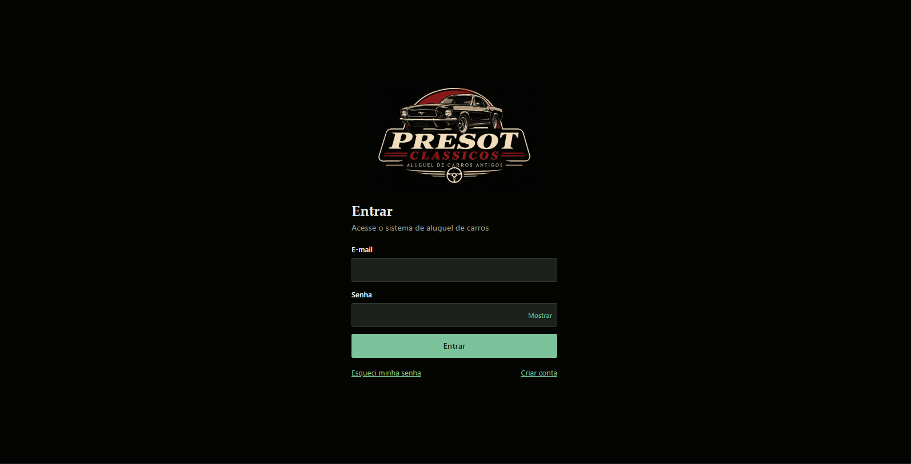
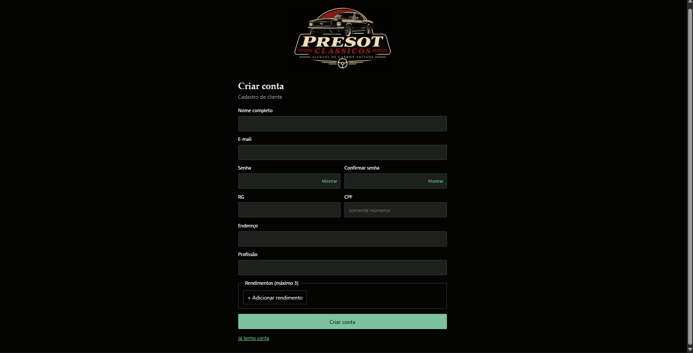
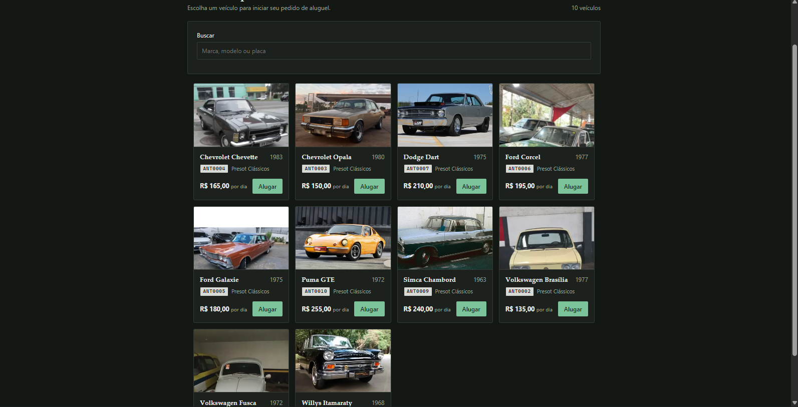
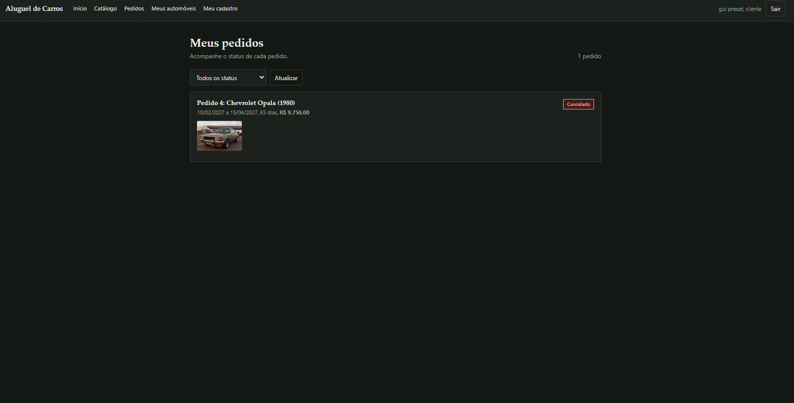
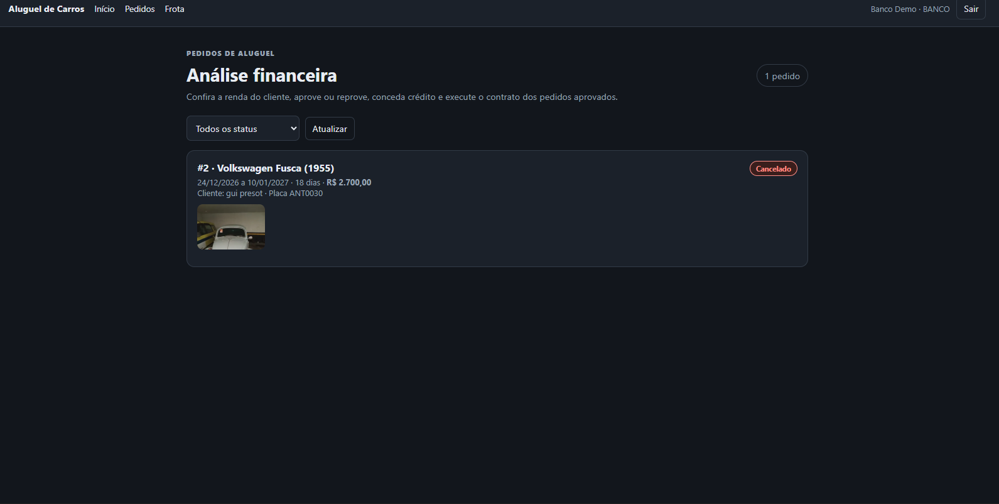
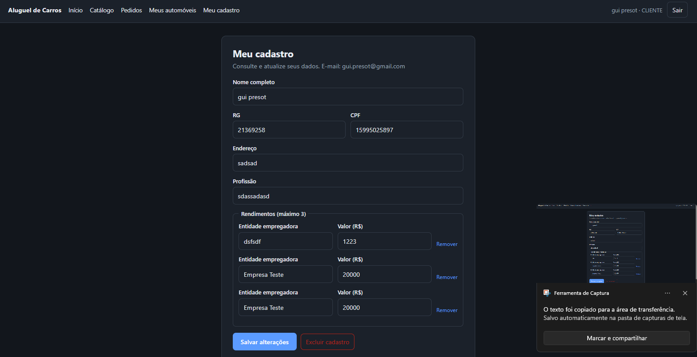

# 🚗 Presot Clássicos — Sistema de Aluguel de Carros 🔑

> [!NOTE]
> Sistema web para gestão de aluguéis de automóveis clássicos: o cliente cria e acompanha pedidos pela Internet, a empresa aceita ou recusa, e o banco faz a análise financeira e concede crédito até a execução do contrato.

<table>
  <tr>
    <td width="800px">
      <div align="justify">
        Projeto do <b>Laboratório 02</b> da disciplina <b>Desenvolvimento e Integração de Aplicações Web (DIAW)</b>, do curso de Engenharia de Software da <b>PUC Minas</b>. O sistema cobre o ciclo completo de um aluguel: <i>cadastro e login</i>, <i>pedido de aluguel</i>, <i>avaliação da empresa</i>, <i>análise financeira do banco</i>, <i>contrato de crédito</i> e <i>execução do contrato</i>. O back-end é uma API REST em <b>Spring Boot</b> (arquitetura MVC), o front-end é uma SPA em <b>React + Vite</b> e os dados ficam em um banco <b>PostgreSQL no Supabase</b>.
      </div>
    </td>
  </tr>
</table>

---

## 🚧 Status do Projeto

       

---

## 📚 Índice
- [Links Úteis](#-links-úteis)
- [Sobre o Projeto](#-sobre-o-projeto)
- [Funcionalidades Principais](#-funcionalidades-principais)
- [Tecnologias Utilizadas](#-tecnologias-utilizadas)
- [Arquitetura](#-arquitetura)
  - [Diagramas](#diagramas)
- [Instalação e Execução](#-instalação-e-execução)
  - [Pré-requisitos](#pré-requisitos)
  - [Variáveis de Ambiente](#-variáveis-de-ambiente)
  - [Instalação de Dependências](#-instalação-de-dependências)
  - [Inicialização do Banco de Dados (Supabase)](#-inicialização-do-banco-de-dados-supabase)
  - [Como Executar a Aplicação](#-como-executar-a-aplicação)
- [Deploy](#-deploy)
- [Estrutura de Pastas](#-estrutura-de-pastas)
- [Demonstração](#-demonstração)
- [Testes](#-testes)
- [Documentações utilizadas](#-documentações-utilizadas)
- [Autores](#-autores)
- [Contribuição](#-contribuição)
- [Agradecimentos](#-agradecimentos)
- [Licença](#-licença)

---

## 🔗 Links Úteis
* 📖 **Modelagem (UML):** [`docs/modelagem.md`](./docs/modelagem.md)
  > 📚 **Descrição:** Casos de uso, histórias de usuário, diagrama de classes, estados do pedido e diagrama de pacotes (versão 1.3).
* 🗄️ **Migração do banco:** [`docs/migracao_status_contratado.sql`](./docs/migracao_status_contratado.sql)
  > 💾 **Descrição:** Script a executar uma única vez no SQL Editor do Supabase, se o banco foi criado antes do status `CONTRATADO`.

---

## 📝 Sobre o Projeto

O **Presot Clássicos** nasceu como o Laboratório 02 de DIAW: construir um sistema que apoie a gestão de aluguéis de automóveis e permita **efetuar, cancelar e modificar pedidos através da Internet**.

**Qual problema resolve:** centraliza em um só lugar o pedido do cliente, a decisão da empresa dona do carro e a análise financeira do banco, que antes ficariam espalhadas entre telefonemas e planilhas.

**Como funciona:**

- O sistema só é usado após **cadastro prévio e login** (e-mail e senha).
- **Clientes** introduzem, modificam, consultam e cancelam pedidos de aluguel. Guardam RG, CPF, nome, endereço, profissão e até **3 rendimentos** com a entidade empregadora.
- **Agentes** (empresas e bancos) modificam e avaliam pedidos. A empresa aceita ou recusa; o banco avalia a capacidade financeira do cliente e pode conceder um **contrato de crédito**. Pedido aprovado vai para a **execução do contrato**.
- Os **automóveis** (matrícula, ano, marca, modelo e placa) pertencem a um cliente, a uma empresa ou a um banco, e a frota de demonstração é de carros antigos.

> [!NOTE]
> Contas de **Empresa** e **Banco** não têm cadastro aberto: são criadas na inicialização do servidor (veja [Contas de demonstração](#contas-de-demonstração)).

---

## ✨ Funcionalidades Principais

- 🔐 **Autenticação segura:** cadastro de cliente, login com JWT e recuperação de senha por e-mail.
- 👤 **CRUD de cliente:** consultar, alterar e excluir o próprio cadastro, com até 3 rendimentos.
- 📝 **Pedidos de aluguel:** criar, consultar o status, modificar datas e cancelar.
- ✅ **Avaliação pela empresa:** aceitar ou recusar pedidos dos automóveis de sua propriedade, com motivo registrado.
- 🏦 **Análise financeira pelo banco:** aprovar (parcela de até 30% da renda) ou reprovar, com parecer, responsável e data.
- 💳 **Contrato de crédito:** o banco concede crédito a um pedido aprovado, com valor financiado e taxa de juros mensal.
- 📄 **Execução do contrato:** pedido aprovado passa para o status `CONTRATADO`.
- 🚘 **Gestão de automóveis e fotos:** cadastro de frota com valor da diária e upload de foto; catálogo para o cliente.

### Ciclo de vida do pedido



---

## 🛠 Tecnologias Utilizadas

### 💻 Front-end

* **Framework/Biblioteca:** React 19 + React Router 7
* **Linguagem/Superset:** TypeScript 5.9
* **Estilização:** CSS puro (`src/index.css`)
* **Gerenciamento de Estado:** Context API (sessão do usuário)
* **Build Tool:** Vite 8

### 🖥️ Back-end

* **Linguagem/Runtime:** Java 25 (JDK)
* **Framework:** Spring Boot 4.0.9 (Spring MVC, Spring Security, Bean Validation, Spring Mail)
* **Banco de Dados:** PostgreSQL hospedado no Supabase
* **ORM / Query Builder:** Hibernate / Spring Data JPA
* **Autenticação:** JWT (jjwt 0.12.6) com senhas em BCrypt
* **Build e dependências:** Apache Maven (Maven Wrapper incluso)

---

## 🏗 Arquitetura

O back-end segue a arquitetura **MVC em camadas**: `controller` recebe as requisições HTTP, `service` concentra as regras de negócio, `repository` acessa o banco via JPA e `model` guarda as entidades. Os `dto` isolam o contrato da API das entidades, e `security`, `config` e `exception` tratam autenticação, configuração e erros. O front-end é uma SPA que conversa com a API por HTTP/JSON, enviando o JWT no cabeçalho `Authorization`.

**Decisões importantes:**

- **Acesso ao banco só pelo Spring Boot.** O front-end nunca fala direto com o Supabase; a Data API fica desligada.
- **Sessão sem estado (stateless):** JWT com expiração de 60 minutos.
- **Regras de permissão no back-end:** o cliente só vê os próprios pedidos; a empresa só atua em automóveis de sua propriedade; só o banco faz análise financeira e concede crédito.

### Diagramas

Diagrama de pacotes (visão lógica). Os demais diagramas estão em [`docs/modelagem.md`](./docs/modelagem.md).



---

## 🔧 Instalação e Execução

### Pré-requisitos

* **Java JDK:** versão **25** (necessário para o back-end)
* **Node.js:** versão LTS (v20 ou superior) com **npm** (necessário para o front-end)
* **Projeto no Supabase** com o banco PostgreSQL criado
* **Maven:** opcional, pois o projeto inclui o Maven Wrapper (`mvnw`)

---

### 🔑 Variáveis de Ambiente

#### 1. Back-end (Spring Boot)

Defina como **variáveis de ambiente do sistema** antes de iniciar o back-end. O arquivo `application.properties` lê todas elas.

| Variável | Descrição | Exemplo |
| :--- | :--- | :--- |
| `SUPABASE_DB_URL` | URL JDBC do banco (use a string do **Session pooler** em *Connect* no painel do Supabase). | `jdbc:postgresql://aws-0-us-east-1.pooler.supabase.com:5432/postgres` |
| `SUPABASE_DB_USER` | Usuário do banco. | `postgres.abcdefghijklmnop` |
| `SUPABASE_DB_PASSWORD` | Senha do banco. | `sua-senha-do-banco` |
| `JWT_SECRET` | Chave secreta para assinar os tokens (use um valor longo e aleatório). | `chave_longa_e_aleatoria_com_pelo_menos_32_caracteres` |
| `SEED_AGENT_PASSWORD` | *(Opcional)* Senha das contas de empresa e banco criadas na inicialização. Padrão: `123456`. | `outra-senha` |

No PowerShell (Windows), na mesma janela em que vai rodar o back-end:

```powershell
$env:SUPABASE_DB_URL = "jdbc:postgresql://aws-0-us-east-1.pooler.supabase.com:5432/postgres"
$env:SUPABASE_DB_USER = "postgres.abcdefghijklmnop"
$env:SUPABASE_DB_PASSWORD = "sua-senha-do-banco"
$env:JWT_SECRET = "chave_longa_e_aleatoria_com_pelo_menos_32_caracteres"
```

No Linux/macOS, use `export NOME="valor"`.

> [!IMPORTANT]
> Nunca versione senhas ou chaves. O `.gitignore` da raiz já ignora arquivos `.env`.

#### 2. Front-end (React, Vite)

Opcional. Sem configuração, o front-end chama a API em `http://localhost:8080`. Para apontar para outro endereço, crie `frontend/.env.local`:

| Variável | Descrição | Exemplo |
| :--- | :--- | :--- |
| `VITE_API_URL` | URL base do back-end Spring Boot. | `http://localhost:8080` |

---

### 📦 Instalação de Dependências

1. **Clone o repositório:**

```bash
git clone https://github.com/<seu-usuario>/Sistema-de-Aluguel-de-Carros.git
cd Sistema-de-Aluguel-de-Carros
```

2. **Front-end (React):**

```bash
cd frontend
npm install
cd ..
```

3. **Back-end (Spring Boot):** as dependências são baixadas pelo Maven na primeira execução. Para baixá-las antes, sem rodar os testes (que precisam do banco):

```bash
cd backend
./mvnw clean install -DskipTests
cd ..
```

> No Windows, use `mvnw.cmd` no lugar de `./mvnw`.

---

### 💾 Inicialização do Banco de Dados (Supabase)

1. Crie um projeto no [Supabase](https://supabase.com/) e copie os dados de conexão em **Connect**.
2. Defina as variáveis `SUPABASE_DB_*` (seção anterior).
3. **Não é preciso criar tabelas à mão.** O Hibernate cria e atualiza o schema na inicialização (`spring.jpa.hibernate.ddl-auto=update`).
4. Se o banco já existia antes do status `CONTRATADO`, execute **uma vez** o script [`docs/migracao_status_contratado.sql`](./docs/migracao_status_contratado.sql) no **SQL Editor** do Supabase.

#### Contas de demonstração

Na primeira inicialização, o back-end cria as contas de agentes e a frota de demonstração (20 carros antigos, 2 de cada modelo, com foto).

| Perfil | E-mail | Senha |
| :--- | :--- | :--- |
| 🏢 Empresa (Presot Clássicos) | `empresa@teste.com` | `123456` (ou o valor de `SEED_AGENT_PASSWORD`) |
| 🏦 Banco (Banco Demo) | `banco@teste.com` | `123456` (ou o valor de `SEED_AGENT_PASSWORD`) |

Clientes se cadastram pela tela **Cadastro** do front-end.

> [!NOTE]
> A frota só é criada se a tabela de automóveis estiver vazia. As contas e os carros existentes nunca são alterados na inicialização.

---

### ⚡ Como Executar a Aplicação

Execute em **dois terminais separados**.

#### Terminal 1: Back-end (Spring Boot)

```bash
cd backend
./mvnw spring-boot:run
```
🚀 *O back-end estará disponível em **http://localhost:8080**.*

> Em desenvolvimento o e-mail de recuperação de senha **não é enviado**: o texto com o link aparece no log do back-end.

---

#### Terminal 2: Front-end (React, Vite)

```bash
cd frontend
npm run dev
```
🎨 *O front-end estará disponível em **http://localhost:5173**.*

---

## 🚀 Deploy

1. **Build do projeto:**

```bash
# Front-end (React/Vite) - gera a pasta frontend/dist com arquivos estáticos
cd frontend
npm run build

# Back-end (Spring Boot/Maven) - gera o JAR executável em backend/target
cd ../backend
./mvnw clean package -DskipTests
```

2. **Configuração do ambiente de produção:** defina as variáveis `SUPABASE_DB_*` e `JWT_SECRET` no provedor, além de `APP_CORS_ORIGIN` (URL do front-end publicado) e `APP_FRONTEND_URL` (usada no link de recuperação de senha). No build do front-end, defina `VITE_API_URL` com a URL pública do back-end.

3. **Execução em produção:**

```bash
# Back-end
java -jar backend/target/aluguel-0.0.1-SNAPSHOT.jar

# Front-end: sirva os arquivos estáticos (Nginx, Vercel, Netlify ou o pacote 'serve')
npm install -g serve
serve -s frontend/dist
```

---

## 📂 Estrutura de Pastas

```
.
├── .gitignore                    # 🧹 Ignora node_modules, target, dist, .env, etc.
├── README.md                     # 📘 Documentação principal do projeto.
├── LICENSE                       # ⚖️ Licença MIT.
│
├── /frontend                     # 📁 Aplicação React + Vite (TypeScript)
│   ├── /public                   # 📂 Arquivos estáticos (favicon).
│   ├── /src
│   │   ├── /auth                 # 🔐 Contexto de sessão, provider e rota protegida.
│   │   ├── /components           # 🧱 Componentes reutilizáveis (Topo, CarCard, CarList, campos).
│   │   ├── /pages                # 📄 Telas: Login, Cadastro, Pedidos, Catálogo, Frota, Meu cadastro...
│   │   ├── /types                # 🧬 Tipos TypeScript (Automóvel, Aluguel).
│   │   ├── api.ts                # 🔌 Cliente HTTP da API (token JWT, erros).
│   │   ├── format.ts             # 🛠️ Formatação de datas e valores.
│   │   └── main.tsx              # 🚪 Ponto de entrada.
│   ├── index.html
│   ├── vite.config.ts
│   └── package.json              # 📦 Dependências e scripts.
│
├── /backend                      # 📁 API Spring Boot
│   ├── /src/main/java/br/com/carro/aluguel
│   │   ├── /controller           # 🎮 Endpoints REST (auth, clientes, automóveis, aluguéis).
│   │   ├── /service              # ⚙️ Regras de negócio.
│   │   ├── /repository           # 🗄️ Repositórios Spring Data JPA.
│   │   ├── /model                # 🧬 Entidades JPA e enums.
│   │   ├── /dto                  # ✉️ Objetos de requisição e resposta.
│   │   ├── /security             # 🛡️ JWT e filtro de autenticação.
│   │   ├── /config               # 🔧 Segurança, CORS e dados de demonstração.
│   │   ├── /exception            # 💥 Exceções e handler global.
│   │   └── /util                 # 🛠️ Política de senha e validação de entradas.
│   ├── /src/main/resources
│   │   ├── application.properties  # ⚙️ Configuração (lê as variáveis de ambiente).
│   │   └── /fotos-demo             # 🖼️ Fotos dos modelos da frota de demonstração.
│   ├── /src/test/java            # 🧪 Testes.
│   ├── mvnw / mvnw.cmd           # 🛠️ Maven Wrapper.
│   └── pom.xml                   # 📦 Build e dependências.
│
└── /docs                         # 📚 Modelagem UML e scripts de banco.
    ├── modelagem.md              # 📐 Casos de uso, histórias, classes, estados e pacotes.
    ├── migracao_status_contratado.sql
    └── /img                      # 🖼️ Capturas de tela usadas no README.
```

---

## 🎥 Demonstração

### 🌐 Aplicação Web

| Tela | Captura de Tela |
| :---: | :---: |
| **Login** |  |
| **Cadastro de Cliente** |  |
| **Catálogo de Automóveis** |  |
| **Pedidos e Status** |  |
| **Análise do Banco** |  |
| **Meu Cadastro (CRUD)** |  |

### 💻 Exemplo de Saída no Terminal (API)

Login e consulta dos pedidos do cliente autenticado:

```bash
# 1. Login (retorna o token JWT)
curl -X POST 'http://localhost:8080/api/auth/login' \
     -H 'Content-Type: application/json' \
     -d '{"email": "cliente@exemplo.com", "senha": "SuaSenha123"}'

# 2. Lista os pedidos do cliente
curl -X GET 'http://localhost:8080/api/alugueis/meus' \
     -H 'Authorization: Bearer <seu-jwt-token>'
```

#### Principais endpoints

| Método | Rota | Descrição |
| :--- | :--- | :--- |
| `POST` | `/api/auth/registro` | Cadastra um cliente. |
| `POST` | `/api/auth/login` | Autentica e devolve o JWT. |
| `POST` | `/api/auth/recuperar-senha` | Inicia a recuperação de senha. |
| `GET` `PUT` `DELETE` | `/api/clientes/me` | Consulta, altera e exclui o próprio cadastro. |
| `GET` | `/api/automoveis/disponiveis` | Catálogo de automóveis disponíveis. |
| `POST` | `/api/alugueis` | Cliente introduz um pedido. |
| `GET` | `/api/alugueis/meus` | Pedidos do cliente. |
| `GET` | `/api/alugueis/agente` | Pedidos para o agente (empresa ou banco). |
| `PUT` | `/api/alugueis/{id}/aceitar` · `/recusar` | Empresa aceita ou recusa. |
| `PUT` | `/api/alugueis/{id}/parecer` | Banco aprova ou reprova. |
| `POST` | `/api/alugueis/{id}/credito` | Banco concede contrato de crédito. |
| `PUT` | `/api/alugueis/{id}/contrato` | Executa o contrato. |
| `PUT` | `/api/alugueis/{id}/datas` | Modifica as datas do pedido. |
| `DELETE` | `/api/alugueis/{id}` | Cliente cancela o pedido. |

---

## 🧪 Testes

O back-end tem um teste de carga de contexto (`AluguelApplicationTests`). Ele sobe a aplicação inteira, então **precisa das variáveis de ambiente do banco** definidas:

```bash
cd backend
./mvnw test
```
*Ferramentas: JUnit 5 e Spring Boot Test.*

Para checar o front-end:

```bash
cd frontend
npm run lint
npm run build
```

---

## 🔗 Documentações utilizadas

* 📖 **Front-end:** [React](https://react.dev/reference/react) · [Vite](https://vite.dev/config/) · [React Router](https://reactrouter.com/)
* 📖 **Back-end:** [Spring Boot](https://docs.spring.io/spring-boot/index.html) · [Spring Security](https://docs.spring.io/spring-security/reference/)
* 📖 **Banco de dados:** [Supabase](https://supabase.com/docs)
* 📖 **Modelagem:** [Documento de modelagem do projeto](./docs/modelagem.md)
* 📖 **Guia de Estilo:** [Conventional Commits](https://www.conventionalcommits.org/en/v1.0.0/)

### 🖼️ Créditos das fotos de demonstração

As fotos dos modelos em `backend/src/main/resources/fotos-demo/` vieram do Wikimedia Commons (licença livre). *Adicione aqui o autor e a licença de cada foto.*

---

## 👥 Autores

| 👤 Nome | :octocat: GitHub | 💼 LinkedIn | 📤 E-mail |
|---------|-----------------|-------------|-----------|
| Guilherme Presot | [github.com/seu-usuario](https://github.com/gpresot) | [linkedin.com/in/seu-perfil](https://www.linkedin.com/in/guilhermepresot/) | [seu-email@exemplo.com](mailto:gui.presot@gmail.com) |

---

## 🤝 Contribuição

1. Faça um `fork` do projeto.
2. Crie uma branch para sua feature (`git checkout -b feature/minha-feature`).
3. Faça commit das mudanças (`git commit -m 'feat: adiciona nova funcionalidade X'`), seguindo o [Conventional Commits](https://www.conventionalcommits.org/en/v1.0.0/).
4. Envie a branch (`git push origin feature/minha-feature`).
5. Abra um **Pull Request**.

---

## 🙏 Agradecimentos

* [**Engenharia de Software PUC Minas**](https://www.instagram.com/engsoftwarepucminas/) — pelo apoio institucional e pela estrutura acadêmica.
* [**Prof. Dr. João Paulo Aramuni**](https://github.com/joaopauloaramuni) — pelos ensinamentos de Desenvolvimento e Integração de Aplicações Web e pelo template de documentação usado neste README.

---

## 📄 Licença

Este projeto é distribuído sob a **[Licença MIT](./LICENSE)**.

---
