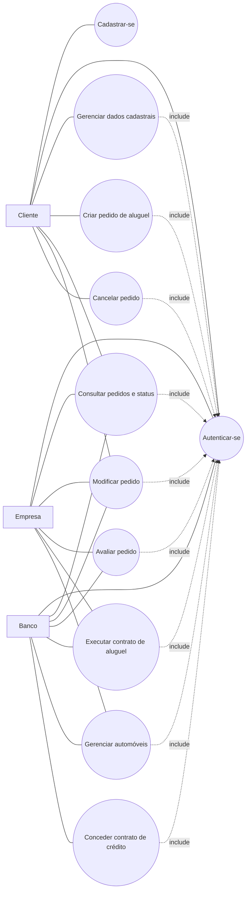
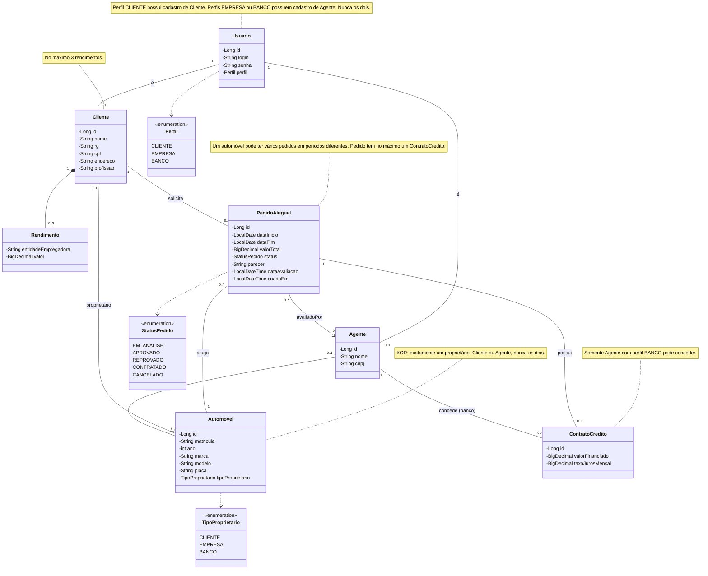
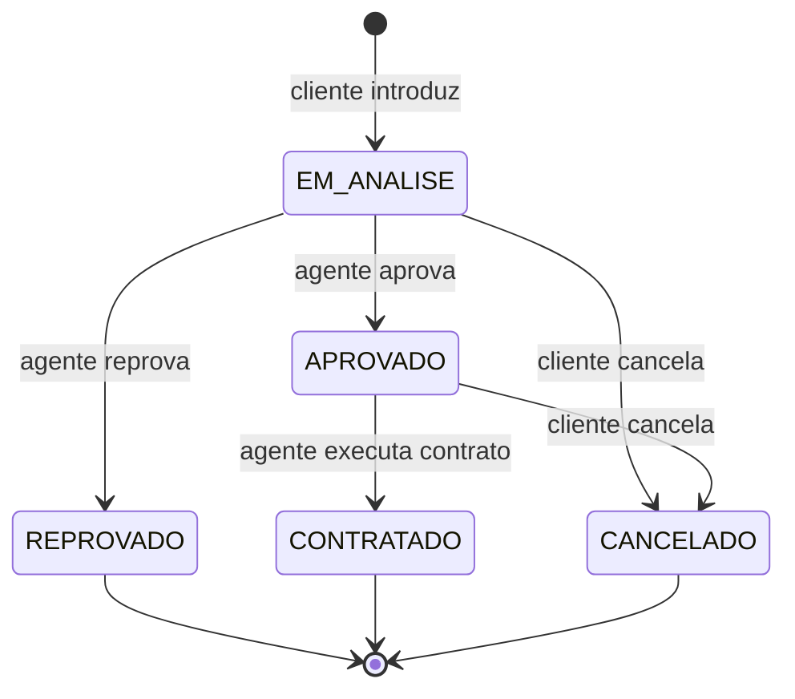

# Sistema de Aluguel de Carros — Documento de Modelagem

## 1. Diagrama de Casos de Uso

### Regras de acesso

- O usuário precisa estar autenticado para executar operações protegidas.
- O Cliente pode gerenciar apenas o próprio cadastro e consultar, modificar ou cancelar apenas os próprios pedidos, respeitando as regras de status.
- Empresa e Banco podem consultar e modificar pedidos somente quando tiverem autorização para atuar sobre eles.
- Somente agentes com perfil EMPRESA ou BANCO podem avaliar pedidos.
- Somente agentes com perfil BANCO podem conceder contratos de crédito.
- Somente agentes autorizados podem executar contratos de aluguel.
- O cadastro inicial e a autenticação são as únicas operações disponíveis sem uma sessão autenticada.

## 2. Histórias de Usuário

| ID | Como... | Quero... | Para... | Critérios de aceite |
|----|---------|----------|---------|---------------------|
| US01 | visitante | me cadastrar com usuário e senha, informando RG, CPF, nome, endereço, profissão e até 3 rendimentos | usar o sistema | login, CPF e RG únicos; máximo de 3 rendimentos |
| US02 | usuário cadastrado | fazer login com usuário e senha | acessar as funções do meu perfil | sem login o acesso é negado; senha inválida é rejeitada |
| US03 | cliente | consultar, alterar e excluir meu cadastro | manter meus dados atualizados | acesso só ao próprio cadastro |
| US04 | cliente | introduzir um pedido de aluguel | alugar um automóvel | datas válidas; pedido nasce EM_ANALISE |
| US05 | cliente | consultar o status dos meus pedidos | acompanhar a análise | lista apenas os meus pedidos |
| US06 | cliente ou agente autorizado (Empresa ou Banco) | modificar um pedido | corrigir dados | somente pedidos em EM_ANALISE; cliente só modifica os próprios pedidos; agente só modifica pedidos sobre os quais possui autorização |
| US07 | cliente | cancelar um pedido | desistir do aluguel | somente pedidos próprios em EM_ANALISE ou APROVADO |
| US08 | agente autorizado (Empresa ou Banco) | avaliar financeiramente um pedido | aprová-lo ou reprová-lo | registra parecer, responsável e data da avaliação; somente pedidos em EM_ANALISE |
| US09 | agente com perfil Banco | conceder contrato de crédito a um pedido aprovado | financiar o aluguel | somente perfil BANCO; informa valor financiado e taxa de juros mensal; contrato fica vinculado ao pedido |
| US10 | agente autorizado (Empresa ou Banco) | executar o contrato de um pedido aprovado | formalizar o aluguel | somente pedidos em APROVADO; após a execução, status passa a CONTRATADO |
| US11 | agente autorizado (Empresa ou Banco) | cadastrar e manter automóveis | disponibilizar a frota | matrícula e placa únicas; cada automóvel possui exatamente um proprietário: Cliente ou Agente |

## 3. Diagrama de Classes

## 4. Estados do Pedido

## 5. Diagrama de Pacotes (Visão Lógica)

```mermaid
flowchart TB
    subgraph Frontend[Front-end React + Vite]
        pages[pages]
        components[components]
        api[api]
    end
    subgraph Backend[Back-end Spring Boot - MVC]
        controller[controller]
        service[service]
        repository[repository]
        model[model]
        dto[dto]
        security[security]
        exception[exception]
    end
    DB[(Supabase PostgreSQL)]

    pages --> components
    pages --> api
    api -- HTTP/JSON --> controller
    controller --> dto
    controller --> service
    service --> repository
    service --> model
    repository --> model
    security --> service
    controller --> exception
    repository -- JDBC --> DB
```

## Histórico de versões

| Versão | Data | Mudança |
|--------|------|---------|
| 1.0 | 2026-11-02 | Versão inicial |
| 1.1 | 2026-11-02 | Atualização do diagrama de classes: inclusão do responsável e data da avaliação, exclusividade entre Cliente e Agente e definição de proprietário único para automóveis. |
| 1.2 | 2026-11-02 | Esclarecimento das permissões de Empresa e Banco, das regras de modificação e cancelamento de pedidos, da avaliação e da concessão de crédito. |
