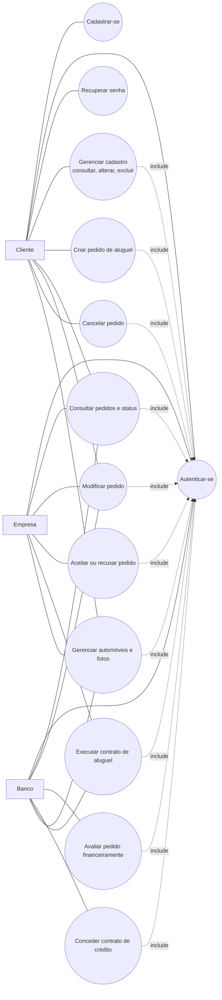
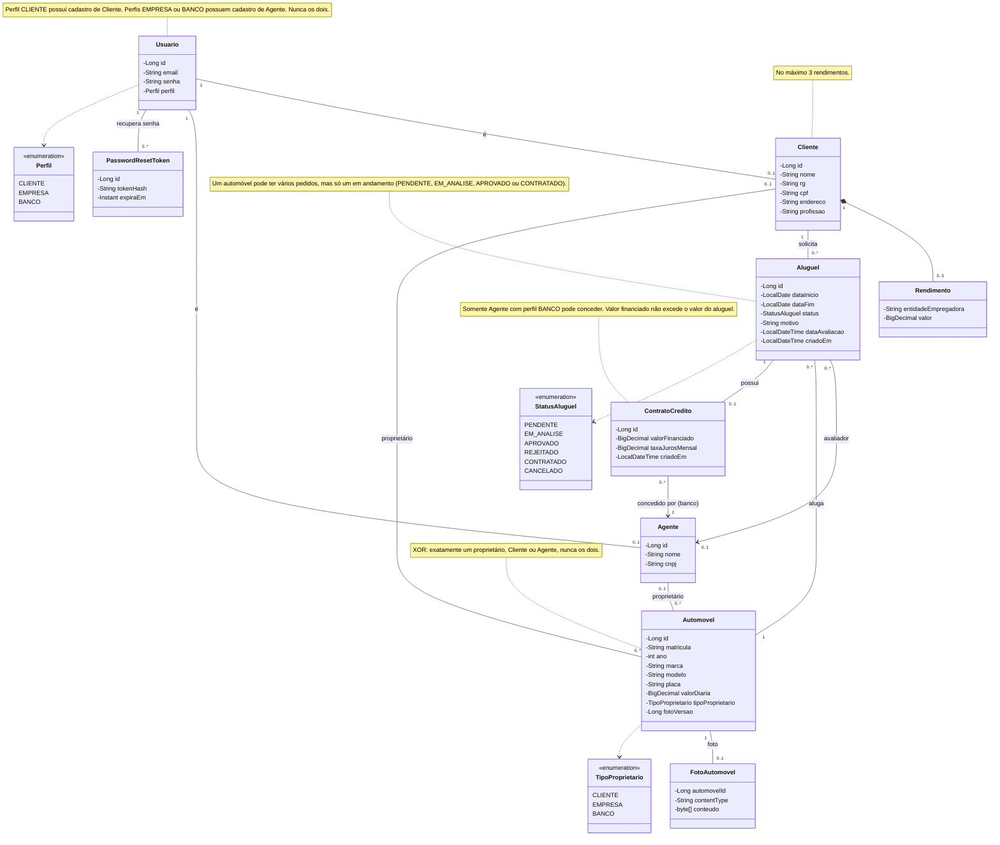
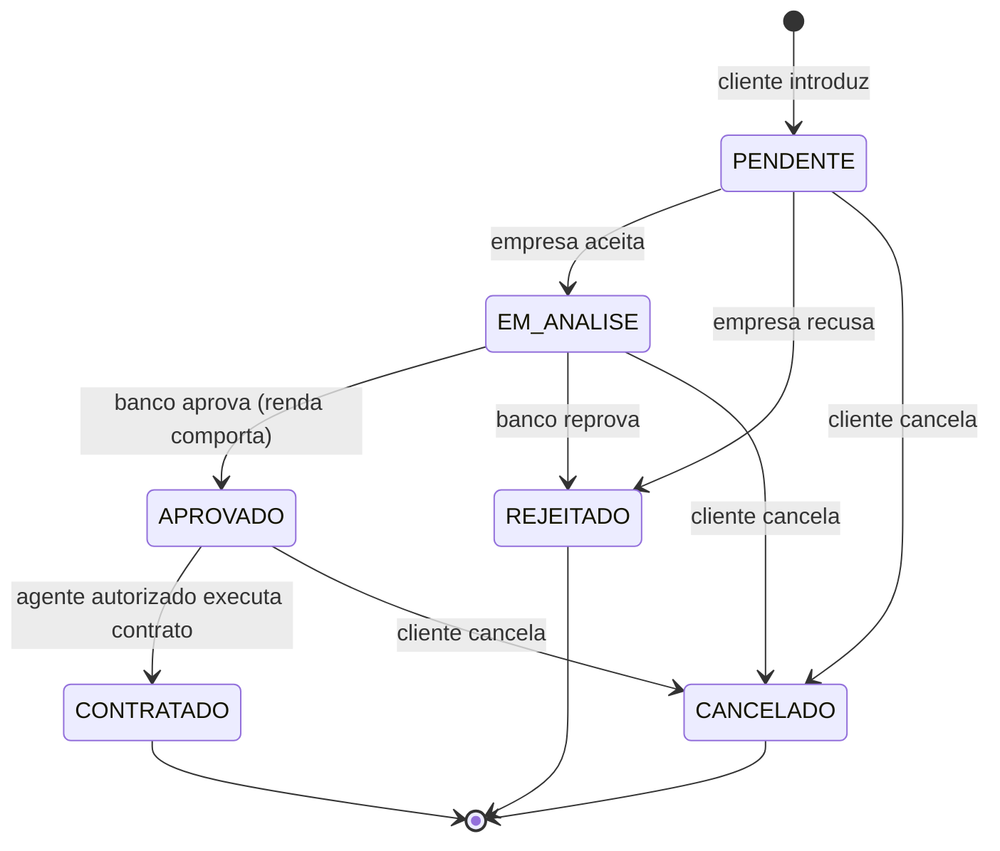
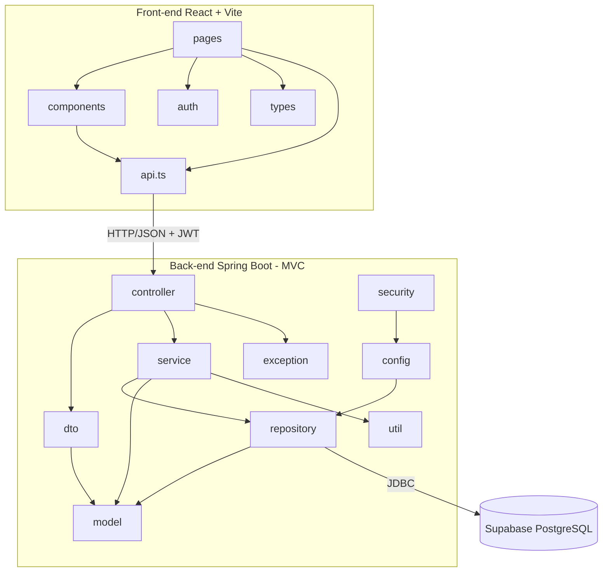

# Sistema de Aluguel de Carros — Documento de Modelagem

> Versão 1.4 — alinhada ao código (`backend/src/main/java/br/com/carro/aluguel`).

## 1. Diagrama de Casos de Uso

### Regras de acesso

- O cadastro de cliente, o login e a recuperação de senha são as únicas operações sem sessão autenticada (além da leitura da foto do automóvel, carregada por tag `img`).
- Agentes (Empresa e Banco) não se cadastram pela API: as contas são criadas na inicialização do servidor.
- O Cliente acessa apenas o próprio cadastro e os próprios pedidos.
- A Empresa só atua sobre pedidos de automóveis de sua propriedade.
- Somente o Banco faz a análise financeira e concede contratos de crédito.
- Executam o contrato de um pedido aprovado: a Empresa dona do automóvel ou o Banco que avaliou o pedido ou concedeu o crédito.

## 2. Histórias de Usuário

| ID | Como... | Quero... | Para... | Critérios de aceite |
|----|---------|----------|---------|---------------------|
| US01 | visitante | me cadastrar com e-mail e senha, informando RG, CPF, nome, endereço, profissão e até 3 rendimentos | usar o sistema | e-mail, CPF e RG únicos; máximo de 3 rendimentos |
| US02 | usuário cadastrado | fazer login com e-mail e senha | acessar as funções do meu perfil | sem login o acesso é negado; senha inválida é rejeitada |
| US03 | cliente | consultar, alterar e excluir meu cadastro | manter meus dados atualizados | acesso só ao próprio cadastro; exclusão bloqueada se houver pedidos ou automóveis |
| US04 | cliente | introduzir um pedido de aluguel | alugar um automóvel | datas válidas; automóvel sem aluguel em andamento; pedido nasce PENDENTE |
| US05 | cliente | consultar o status dos meus pedidos | acompanhar a análise | lista apenas os meus pedidos |
| US06 | cliente, empresa ou banco | modificar as datas de um pedido | corrigir dados | cliente e empresa: somente PENDENTE; banco: somente EM_ANALISE; cliente só os próprios; empresa só de seus automóveis |
| US07 | cliente | cancelar um pedido | desistir do aluguel | somente pedidos próprios em PENDENTE, EM_ANALISE ou APROVADO; registro fica com status CANCELADO |
| US08 | empresa | aceitar ou recusar um pedido de um automóvel meu | encaminhar ao banco ou encerrar | somente PENDENTE; aceite leva a EM_ANALISE; recusa leva a REJEITADO e registra motivo, responsável e data |
| US09 | banco | avaliar financeiramente um pedido | aprová-lo ou reprová-lo | somente EM_ANALISE; aprovar exige parcela ≤ 30% da renda; reprovar exige motivo; registra parecer, responsável e data |
| US10 | banco | conceder contrato de crédito a um pedido aprovado | financiar o aluguel | somente perfil BANCO; somente APROVADO; informa valor financiado (≤ valor do aluguel) e taxa de juros mensal; um contrato por pedido |
| US11 | empresa ou banco autorizado | executar o contrato de um pedido aprovado | formalizar o aluguel | somente APROVADO; após a execução, status passa a CONTRATADO |
| US12 | empresa, banco ou cliente | cadastrar e manter automóveis, com foto e valor da diária | disponibilizar a frota | matrícula e placa únicas; exatamente um proprietário (Cliente ou Agente); só automóveis de Empresa ou Banco aparecem no catálogo |

## 3. Diagrama de Classes

## 4. Estados do Pedido

O banco pode conceder o contrato de crédito (`ContratoCredito`) enquanto o pedido está APROVADO, antes da execução do contrato.

## 5. Diagrama de Pacotes (Visão Lógica)

## 6. Comparação: Modelo Inicial × Protótipo Final

Esta seção compara o **modelo inicial** (versão 1.0, derivada do enunciado do Laboratório 02, disponível em [`modelo-inicial.md`](./modelo-inicial.md)) com o **protótipo implementado** (versão 1.4, alinhada ao código) e registra as **modificações feitas para o funcionamento adequado do software**.

### 6.1 Modelo de classes e dados

| Elemento | Modelo inicial (v1.0) | Protótipo final | Motivo da mudança |
|----------|-----------------------|-----------------|-------------------|
| Pedido | Classe `PedidoAluguel` | Classe `Aluguel` | Nome alinhado ao domínio e ao código; o pedido é o próprio aluguel em seus vários estados. |
| Avaliação do pedido | Parecer sem rastreio | `Aluguel` guarda `motivo`, `dataAvaliacao` e o `Agente` avaliador | Dar rastreabilidade: quem avaliou, quando e por quê (v1.1). |
| Cliente × Agente | Relação não restrita | `Usuario` é Cliente **ou** Agente, nunca os dois | Evitar contas ambíguas e simplificar as permissões (v1.1). |
| Proprietário do automóvel | Cliente, empresa ou banco, sem restrição | Exatamente **um** proprietário (XOR) com `tipoProprietario` | Garantir consistência: um automóvel não pode ter dois donos (v1.1). |
| Automóvel | matrícula, ano, marca, modelo, placa | Acrescenta `valorDiaria` e `fotoVersao` | Necessário para calcular o valor do aluguel e exibir o catálogo. |
| Foto | Não prevista | `FotoAutomovel` (conteúdo e tipo) | Catálogo visual dos veículos. |
| Contrato de crédito | Citado no enunciado | `ContratoCredito` implementado: valor financiado, taxa de juros mensal, banco concedente; um por pedido | Cumprir o requisito de crédito concedido por um banco agente (v1.3). |
| Recuperação de senha | Não prevista | `PasswordResetToken` (hash do token e expiração) | Complemento de segurança do login. |
| Rendimentos | Até 3 por contratante | `Rendimento` com no máximo 3 por `Cliente` | Mantido conforme o enunciado, agora validado no back-end. |

### 6.2 Regras de negócio e fluxo do pedido

| Aspecto | Modelo inicial (v1.0) | Protótipo final | Motivo da mudança |
|---------|-----------------------|-----------------|-------------------|
| Estados do pedido | Fluxo geral: introduzir, analisar, executar contrato | `PENDENTE`, `EM_ANALISE`, `APROVADO`, `REJEITADO`, `CONTRATADO`, `CANCELADO`, com transições definidas | Tornar o ciclo de vida explícito e testável (v1.3). |
| Análise financeira | "Analisada pelos agentes" | Empresa aceita ou recusa; **só o Banco** avalia a renda. Aprovação exige parcela ≤ **30% da renda** | Definir um critério objetivo e quem é responsável por ele (v1.2). |
| Modificação de pedido | Agentes e clientes modificam | Cliente e Empresa só em `PENDENTE`; Banco só em `EM_ANALISE` | Evitar alteração de pedido já decidido (v1.2 e v1.3). |
| Cancelamento | Cliente cancela | Só pedidos próprios em `PENDENTE`, `EM_ANALISE` ou `APROVADO`; o registro permanece como `CANCELADO` | Preservar o histórico em vez de apagar o pedido. |
| Disponibilidade | Não especificada | Só um pedido em andamento por automóvel | Impedir aluguel duplo do mesmo carro. |
| Execução do contrato | Etapa final do fluxo | Pedido `APROVADO` passa a `CONTRATADO`, executado pela Empresa dona do carro ou pelo Banco avaliador ou concedente | Definir quem pode formalizar o contrato (v1.3). |
| Contas de agentes | Não detalhado | Criadas na inicialização do servidor, não pelo cadastro público | Agentes não devem se auto-cadastrar. |
| Exclusão de cliente | CRUD de cliente | Bloqueada se houver pedidos ou automóveis vinculados | Preservar a integridade dos dados. |

### 6.3 Autenticação e arquitetura

| Aspecto | Modelo inicial (v1.0) | Protótipo final | Motivo da mudança |
|---------|-----------------------|-----------------|-------------------|
| Login | Usuário e senha | **E-mail** e senha, com perfis `CLIENTE`, `EMPRESA` e `BANCO` | E-mail é único por natureza e permite recuperar a senha (v1.3). |
| Sessão | Não detalhada | JWT sem estado, com expiração de 60 minutos, enviado no cabeçalho `Authorization` | Autenticação adequada a uma API consumida por SPA. |
| Acesso ao banco | Supabase (PostgreSQL) | Somente o Spring Boot acessa o banco; o front-end nunca fala com o Supabase | Centralizar as regras e as permissões no back-end. |
| Arquitetura | MVC com Spring Boot | MVC em camadas: `controller`, `service`, `repository`, `model`, com `dto`, `security`, `config`, `exception` e `util` | Separar responsabilidades e isolar a API das entidades (ver seção 5). |
| Front-end | React + Vite | SPA com `pages`, `components`, `auth`, `types` e `api.ts` | Conforme o enunciado, com rotas protegidas por login. |

### 6.4 Requisitos do enunciado atendidos pelo protótipo

| Requisito do enunciado | Situação | Onde |
|------------------------|----------|------|
| Cadastro prévio e login obrigatório | Atendido | `AuthController`, `ProtectedRoute` |
| Cliente introduz, modifica, consulta e cancela pedidos | Atendido | `AluguelController`, tela Pedidos |
| Agentes modificam e avaliam pedidos | Atendido | `AluguelController` (aceitar, recusar, avaliar, modificar) |
| Dados do contratante (RG, CPF, nome, endereço, profissão, até 3 rendimentos) | Atendido | `Cliente`, `Rendimento`, tela Cadastro |
| Automóvel com matrícula, ano, marca, modelo e placa | Atendido | `Automovel`, tela Meus automóveis |
| Propriedade do automóvel: cliente, empresa ou banco | Atendido | `TipoProprietario` |
| Contrato de crédito concedido por um banco agente | Atendido | `ContratoCredito` |
| CRUD de cliente | Atendido | `ClienteController`, tela Meu cadastro |
| Criar e visualizar o status de um pedido | Atendido | Telas Catálogo e Pedidos |
| Spring Boot + MVC, React + Vite, Supabase | Atendido | Ver README |

## Histórico de versões

| Versão | Data | Mudança |
|--------|------|---------|
| 1.0 | 2026-11-02 | Versão inicial |
| 1.1 | 2026-11-02 | Atualização do diagrama de classes: inclusão do responsável e data da avaliação, exclusividade entre Cliente e Agente e definição de proprietário único para automóveis. |
| 1.2 | 2026-11-02 | Esclarecimento das permissões de Empresa e Banco, das regras de modificação e cancelamento de pedidos, da avaliação e da concessão de crédito. |
| 1.3 | 2026-11-02 | Modelo alinhado ao código: `PedidoAluguel` passa a `Aluguel`; login por e-mail; status PENDENTE, EM_ANALISE, APROVADO, REJEITADO, CONTRATADO, CANCELADO; `ContratoCredito` implementado; execução de contrato; CRUD do cliente; banco pode modificar pedidos em análise; inclusão de valorDiaria, foto e recuperação de senha. |
| 1.4 | 2026-11-04 | Inclusão da seção 6, com a comparação entre o modelo inicial e o protótipo final, as modificações feitas para o funcionamento adequado e o atendimento aos requisitos do enunciado. |
