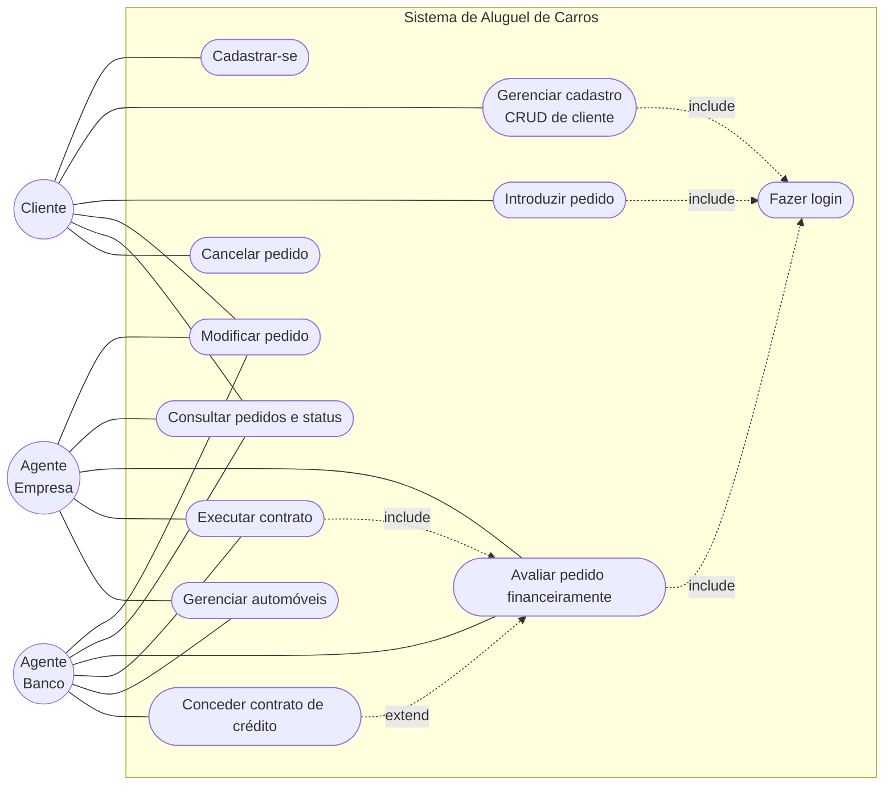
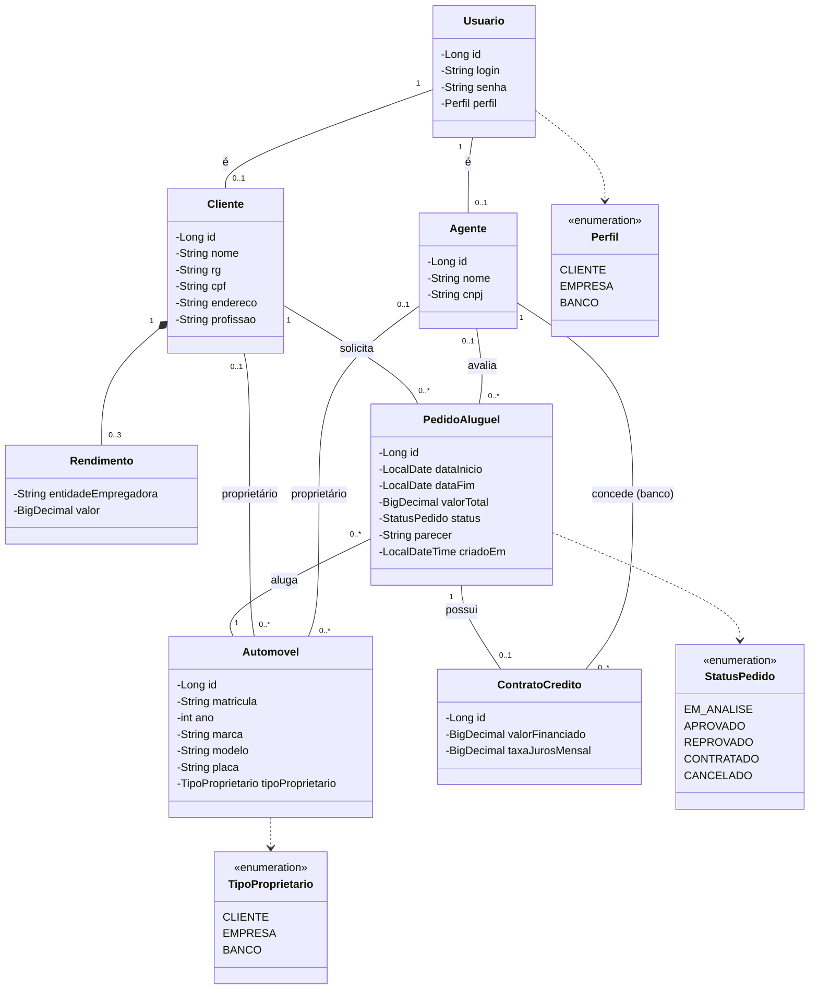
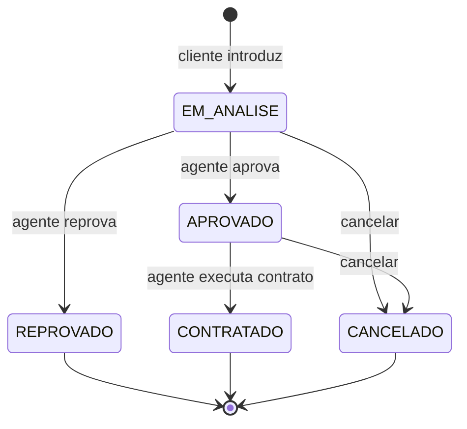
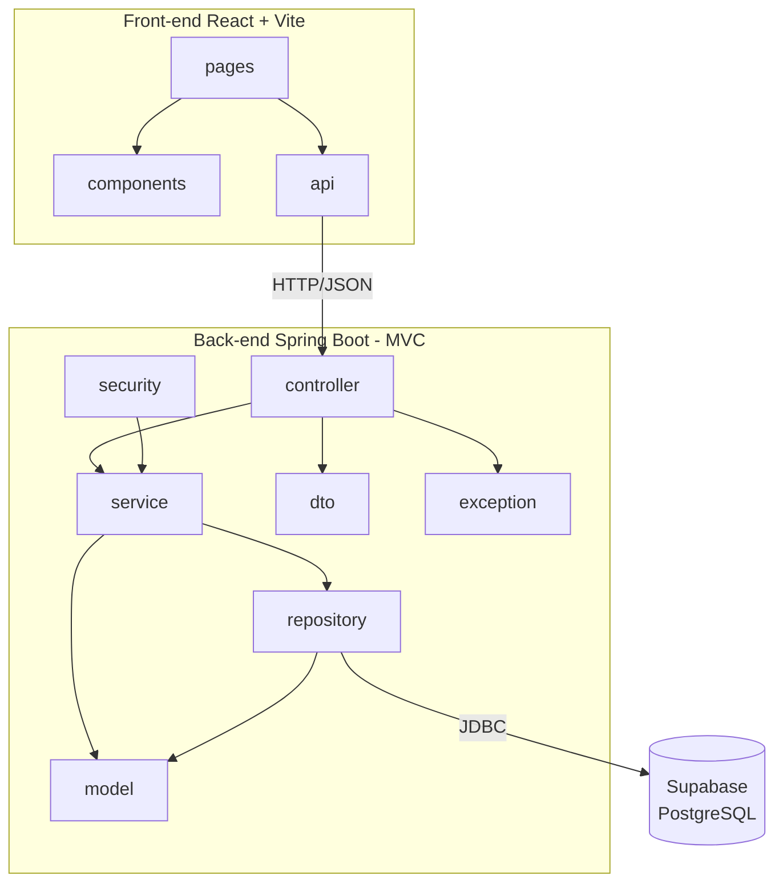

# Modelagem — Sistema de Aluguel de Carros

Diagramas em Mermaid (o GitHub renderiza automaticamente). **Versão 1.0**.

## 1. Diagrama de Casos de Uso

## 2. Histórias de Usuário

| ID | Como... | Quero... | Para... | Critérios de aceite |
|----|---------|----------|---------|---------------------|
| US01 | visitante | me cadastrar com usuário e senha, informando RG, CPF, nome, endereço, profissão e até 3 rendimentos | usar o sistema | login, CPF e RG únicos; máximo de 3 rendimentos |
| US02 | usuário cadastrado | fazer login com usuário e senha | acessar as funções do meu perfil | sem login o acesso é negado; senha inválida é rejeitada |
| US03 | cliente | consultar, alterar e excluir meu cadastro | manter meus dados atualizados | acesso só ao próprio cadastro |
| US04 | cliente | introduzir um pedido de aluguel | alugar um automóvel | datas válidas; pedido nasce `EM_ANALISE` |
| US05 | cliente | consultar o status dos meus pedidos | acompanhar a análise | lista apenas os meus pedidos |
| US06 | cliente ou agente | modificar um pedido | corrigir dados | somente em `EM_ANALISE` |
| US07 | cliente | cancelar um pedido | desistir do aluguel | somente em `EM_ANALISE` ou `APROVADO` |
| US08 | agente | avaliar financeiramente um pedido | aprová-lo ou reprová-lo | registra parecer; só em `EM_ANALISE` |
| US09 | banco | conceder contrato de crédito ao aprovar | financiar o aluguel | só perfil `BANCO`; informa valor e juros |
| US10 | agente | executar o contrato de um pedido aprovado | formalizar o aluguel | só em `APROVADO`; passa a `CONTRATADO` |
| US11 | agente | cadastrar e manter automóveis | disponibilizar a frota | matrícula e placa únicas; proprietário cliente, empresa ou banco |

## 3. Diagrama de Classes

## 4. Estados do Pedido

## 5. Diagrama de Pacotes (Visão Lógica)

## Histórico de versões

| Versão | Data | Mudança |
|--------|------|---------|
| 1.0 | 2026-11-02 | Versão inicial |