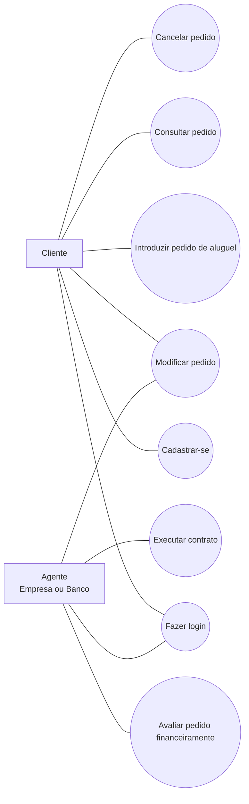
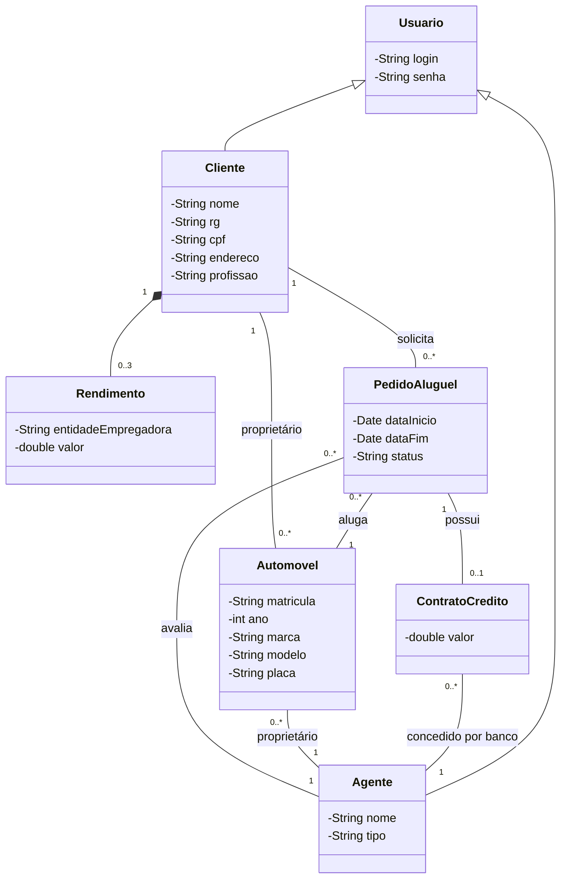
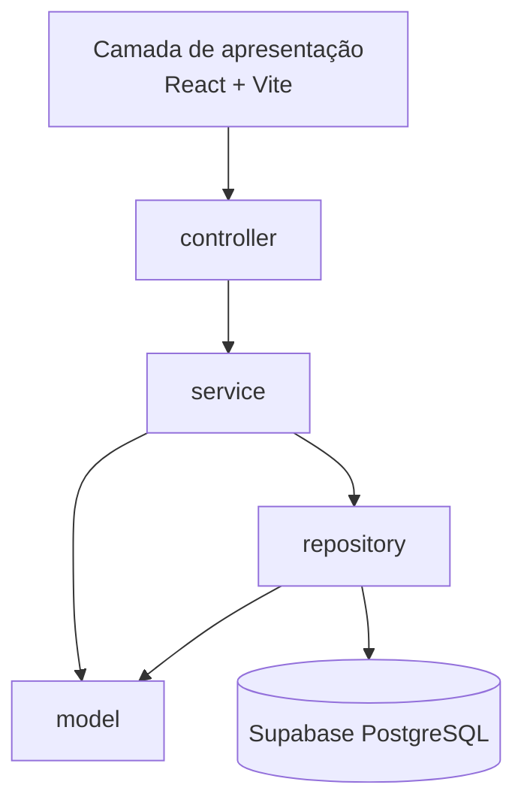

# Sistema de Aluguel de Carros — Modelo Inicial (v1.0)

> Primeira versão da modelagem, feita a partir do enunciado do Laboratório 02, antes da implementação. A evolução até o protótipo final está na seção 6 de [`modelagem.md`](./modelagem.md#6-comparação-modelo-inicial--protótipo-final).

## 1. Casos de Uso

## 2. Histórias de Usuário

| ID | Como... | Quero... | Para... |
|----|---------|----------|---------|
| US01 | cliente | me cadastrar com usuário e senha | usar o sistema |
| US02 | cliente ou agente | fazer login | acessar o sistema |
| US03 | cliente | introduzir um pedido de aluguel | alugar um automóvel |
| US04 | cliente | consultar meus pedidos | acompanhar o andamento |
| US05 | cliente ou agente | modificar um pedido | corrigir dados |
| US06 | cliente | cancelar um pedido | desistir do aluguel |
| US07 | agente | avaliar o pedido financeiramente | decidir se segue para contrato |
| US08 | agente | executar o contrato de um pedido positivo | formalizar o aluguel |

## 3. Diagrama de Classes

## 4. Diagrama de Pacotes (Visão Lógica)

